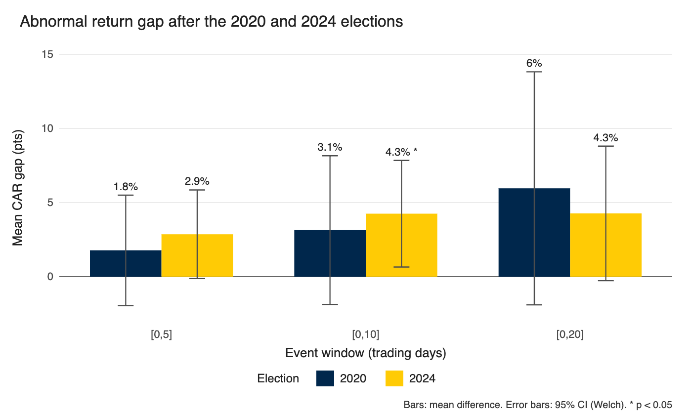

# Market effects of Trump-linked business exposure

Code for my M.A. thesis at the University of Chicago (Committee on International Relations, 2026).

**Question:** do companies with business ties to Donald Trump react differently in the stock market than similar companies without those ties when he loses (2020) or wins (2024) an election?

**Short answer:** after 2020 there was no significant difference. After 2024, connected firms beat their matched controls by **4.25 percentage points** in cumulative abnormal return over the first 10 trading days (Welch t = 2.36, p = 0.021).



## Design

| | |
|---|---|
| Treatment group | 27 U.S.-listed firms with business or financial ties to Trump or his family, from the Sunlight Foundation conflicts-of-interest database |
| Control group | 36 firms: for each connected firm, the 2 closest by FY2020 market cap in the same 2-digit SIC sector (duplicates removed) |
| Events | Day 0 = first trading day after the result: Nov 9, 2020 and Nov 6, 2024 |
| Abnormal return | firm daily return minus S&P 500 value-weighted return |
| Windows | CAR over [0, 5], [0, 10], [0, 20] trading days |
| Pre-event period | 255 trading days, used for volatility checks between groups |
| Tests | one-sample t-tests (is each group's CAR different from 0) and Welch two-sample t-tests (connected vs. control) |

## Results (connected minus control)

| Election | Window | Gap (pts) | 95% CI | p |
|---|---|---:|---|---:|
| 2020 | [0, 5] | 1.78 | −1.95 to 5.50 | 0.344 |
| 2020 | [0, 10] | 3.14 | −1.87 to 8.16 | 0.214 |
| 2020 | [0, 20] | 5.96 | −1.90 to 13.82 | 0.134 |
| 2024 | [0, 5] | 2.86 | −0.13 to 5.85 | 0.060 |
| 2024 | [0, 10] | **4.25** | 0.65 to 7.84 | **0.021** |
| 2024 | [0, 20] | 4.27 | −0.27 to 8.81 | 0.065 |

## Files

```text
R/01_match_controls.R   picks the control firms from Compustat
R/02_compute_car.R      builds abnormal returns and CARs from CRSP daily data
R/03_tests.R            Tables 3 and 4 + the chart above
data/connected_firms.csv   27 connected firms and sector
data/control_firms.csv     control firms and which connected firm each was matched to
data/car_by_firm.csv       firm-level CARs for every event and window (output of step 2)
```

## Running it

Steps 1 and 2 need WRDS access. Compustat and CRSP data are licensed, so the raw files aren't in this repo. Put your own exports in `data/raw/` (`compustat_fy2020.csv`, `crsp_daily.csv`) to rerun them.

Step 3 runs on the included CAR file:

```r
# from the repo root
source("R/03_tests.R")
```

Needs `dplyr`, `tidyr`, `readr`, `ggplot2`.

## Notes and limits

- Three controls (KO, PEP, ALLY) had a missing SIC code in Compustat and were matched by hand using the target firm's sector.
- 63 firms is a small sample, and the 2024 result is significant in one of three windows. I read it as suggestive, not conclusive.
- Market-adjusted returns don't control for factor exposure (size, value, industry momentum), which matters around elections. A market-model or Fama-French version would be the next check.
